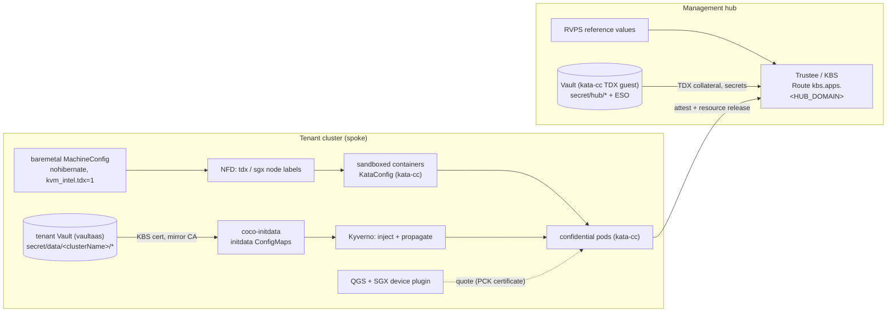

# Architecture

Installation starts at the [Intel TDX runbook](runbook-intel-tdx.md). Abbreviations are in the [glossary](glossary.md).

## Hub and tenant

- **Trustee** is the hub service stack: the **KBS** broker releases resources after
  appraisal, the attestation service verifies evidence, and **RVPS** holds reference values.
- Each node's **QGS** (quote generation service, run by Intel's DCAP operator) signs quotes
  with the platform's **PCK certificate**, imported once per platform. The KBS verifies quotes
  with Intel's **TDX collateral** (TCB info, QE identity, CRLs), loaded from Vault. Both are
  fetched from Intel PCS on the bastion; no cluster talks to Intel.
- The hub **Vault** server pods run in TDX guests too, attested by the same hub Trustee
  ([hub step 12](manual-install-hub.md#step-12-move-vault-into-tdx)).
- Tenants run the runtime, SGX plugin, QGS, Kyverno and initdata generation; no local
  Trustee or ACM hub. Tenant ESO writes only its Vault subtree,
  `secret/data/<clusterName>/*`. It receives the hub KBS certificate and mirror CA,
  byte for byte through PushSecret.

## Attestation and resource release

A `kata-cc` guest sends a TDX quote to the hub KBS. Trustee verifies it with Intel
collateral and appraises firmware/initdata against RVPS. Resource policy then decides
whether to release secrets. An HTTP 200 for `/attest` alone does not establish resource
release: the guest must also obtain its required `/kbs/v0/resource/...` resources.

The inherited CPU policy accepts RTMR2 and XFAM fallback scores even on mismatches;
this is not strict equality for every measurement.

## initdata

`coco-initdata` renders `initdata` and `debug-initdata` ConfigMaps in `imperative`;
Kyverno propagates them to workload namespaces and injects the selected profile as
`io.katacontainers.config.hypervisor.cc_init_data`. Kata measures these bytes into
MRCONFIGID. Select with `coco.io/initdata-configmap`.

The default locked profile disables ordinary exec/log streaming, but its agent policy
still permits policy replacement. The debug profile permits exec/logs and is trusted
for the **same KBS resources**. Neither profile provides per-tenant resource isolation.

Initdata contains the KBS URL/certificate and guest image configuration/mirror CA.
RVPS registers the hub's hashes for **both** profiles. Hub and tenant bytes must match;
keep `coco-initdata` versions aligned and coordinate certificate/CA/template changes
through [operations](operations-runbook.md#coco-initdata-hub-and-tenants-together).

## Guest image pull

Guests pull inside the TEE; host CRI-O mirrors and pull secrets do not apply.
After attestation they fetch shared KBS resources:

| Resource | Purpose |
|---|---|
| `kbs:///default/registry-config/config` | Mirror mappings collected from hub and tenant IDMS/ITMS. |
| `kbs:///default/credential/regcred` | Dedicated read-only registry robots from Vault `secret/hub/tdxRegistryAuth`. |

Mappings and credentials are mutable resources, not measured bytes. The mirror CA is
inline in initdata and **is measured**. All guests receive the same resources.

## Confidential GPU

The NVIDIA operator enables CC mode and binds the GPU to `vfio-pci`; the NVIDIA driver
runs in the guest. Pods use `kata-cc-nvidia-gpu` and request `nvidia.com/pgpu` for cold plug.
The hub's offline NVIDIA `Local` verifier checks report signatures, device chains,
FWID and nonce; GPU policy compares measurements with verified RIM values in RVPS.
GPU evidence is not required by the resource policy, and Local mode does not enforce
certificate revocation. See [GPU limitations](known-issues.md#nvidia-verifier-in-local-mode-h200).

IBM operators retain LLM/CUGA workload ownership. Kyverno mutates pods at creation;
changing policy requires recreating pods. The [confidential GPU steps](manual-install-tenant-gpu.md)
defines NVIDIA stack handover, guest sizing and acceptance.

Site values enter root ArgoCD Applications through parameters; see
[site configuration](../deploy/env/README.md).
