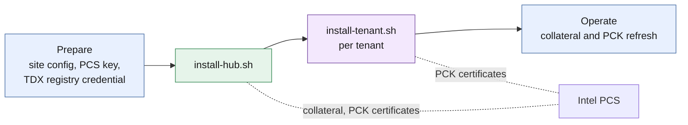

# Install

This is the default installation. One script installs the hub, and one script onboards each tenant.
The scripts run the step scripts in order, wait for reboots and ArgoCD sync, and stop with
instructions where only you can act. The [step reference](#step-reference) says what each step
changes, how to check it and where to look when it fails; `--only <step>` runs one step again.

Read the [security and support limits](known-issues.md) and the [architecture](architecture.md)
first. Abbreviations are in the [glossary](glossary.md).



Blue: the bastion. Green: changes the hub. Purple: changes a tenant. Only the bastion talks to
Intel PCS.

## Before you start

**Hub:**

- Cluster-admin access; OpenShift GitOps with hub OCI repository credentials and TLS trust.
- The Sovereign Core Vault (namespace `vault`) and External Secrets Operator (namespace and
  service account `external-secrets`) are healthy. The Vault Kubernetes-auth role `eso-role`
  can write `secret/data/*`.
- Sovereign Core's ACM (namespace `open-cluster-management`) and cert-manager (namespace
  `cert-manager-operator`) operators are installed. The pattern uses them and does not install
  them; the deploy step stops if either is missing.
- On the bastion: `oc-mirror` v2, `helm`, `oras`, `yq`, `jq`, `git`, `openssl`, `python3`,
  `curl`, `cosign`, `numfmt` (coreutils), Bash, and a checkout of this directory (`runbooks/configurations/intel-tdx` of IBM/SovereignCore). The firmware collector also needs
  `veritas` and `tdx-measure`: after the build, run
  `python3 -m pip install -r requirements-bastion.txt` (pinned; covers upstream's list plus `lxml`) and
  `./build/pattern/scripts/stage-tdx-measure.sh`.
- A maintenance window: the installer reboots the control plane one node at a time and can
  reboot nodes again when TDX and kata are enabled.

**Internet access:** the bastion needs it: the build fetches the pinned upstream sources,
mirroring reads the source registries, and the TDX collateral and PCK certificates come from
Intel PCS. The hub and the tenants never need it.

**Each tenant:**

- The hub is installed and its samples attest.
- The tenant kubeconfig is on the bastion. Download it from OpenShift fleet management (the
  ACM console of the tenant cluster).
- The tenant has the External Secrets Operator and a ready ClusterSecretStore
  `sovcloud-vault-cluster-secret-store` (its own Vault).
- A maintenance window. On a single-node tenant every MachineConfig change reboots the node
  and takes the API down, at least twice per installation.

**Each confidential GPU tenant**, in addition:

- NVIDIA Hopper (H100/H200) with CC-capable firmware; IOMMU enabled in the BIOS. Without TDX the
  GPU also stays out of CC mode.
- A host with NVIDIA RIM/OCSP access for the GPU reference values (`curl`, `jq`, `openssl`,
  `xmlsec1`, `python3` with `lxml`).
- A longer maintenance window: the GPU profile reboots a single-node tenant 2 to 3 times.

**Hardware:** Intel Xeon with TDX, set up as described in Intel's
[Hardware Setup](https://cc-enabling.trustedservices.intel.com/intel-tdx-enabling-guide/04/hardware_setup/)
guide ([hardware prerequisites](runbook-intel-tdx.md#hardware-prerequisites)). Versions used in
validation: [runbook](runbook-intel-tdx.md#component-versions-used-in-validation).

## Prepare

### Site configuration

Put every site value in one file.

**Runs on:** Bastion.

```bash
cp -r deploy/env/example deploy/env/<site>   # edit site.env
export SITE=<site>
. deploy/env/$SITE/site.env
export PATH=$MIRROR_HOME/bin:$PATH           # oc, oc-mirror and helm of the mirror host, if not on PATH
```

Set `EXPECT_HUB_API_SERVER` and `EXPECT_TENANT_API_SERVER` exactly as the `server:` line of
each kubeconfig; every script refuses a kubeconfig that targets another cluster. Point
`HUB_INGRESS_CA_FILE` and `MIRROR_CA_FILE` at the PEM CA bundles of the hub ingress and the
mirror registry: the scripts verify TLS with them and stop when a file is missing. On a first
installation, point `MIRROR_CA_FILE` at the mirror registry's CA. All keys are described in
[deploy/env/README.md](../deploy/env/README.md).

A site file describes one tenant (`TENANT_KUBECONFIG`, `TENANT_CLUSTER`,
`EXPECT_TENANT_API_SERVER`, `TENANT_AGENT_NAMESPACE`). For more tenants, override these in the
environment or keep one site directory per tenant.

**Verify:** `grep server: "$HUB_KUBECONFIG"; echo "$EXPECT_HUB_API_SERVER"` prints the same URL.

**If it fails:** [Wrong-cluster guard error](troubleshooting.md#wrong-cluster-guard-error).

### Trust the hub API certificate (only if needed)

Skip this if `oc whoami` (hub) works. Otherwise embed the hub's root CA into the hub kubeconfig.
The script never fetches the CA from the server: give it the CA file from a source you already
trust. The installer's kubeconfig embeds it.

**Runs on:** Bastion.

```bash
oc config view --raw --kubeconfig=<install-dir>/auth/kubeconfig \
  -o jsonpath='{.clusters[0].cluster.certificate-authority-data}' | base64 -d > hub-api-ca.pem
KUBECONFIG=$HUB_KUBECONFIG CA_FILE=hub-api-ca.pem ./scripts/embed-cluster-ca.sh
```

Without the installer's kubeconfig, ask the cluster administrator for the API root CA file. The
CA survives a later `oc login`; a later `401` only needs a new `oc login`.

### Intel PCS API key

Fetching the PCK certificates of each TDX platform needs your Intel PCS API key, from your Intel
PCS subscription. Write it to `~/.coco-pattern/pccs_api_key` (mode `0600`) on the bastion, or
export `INTEL_PCS_API_KEY`. The key never reaches a cluster; the TDX verification collateral
needs no key.

Before the PCK step sends platform data to Intel PCS, the installer pauses and lists what is
collected, what is sent and where it is stored ([data sent to Intel](../README.md#data-sent-to-intel)).
To confirm, create `~/.coco-pattern/intel-pcs-consent` on the bastion and continue with
`--resume`; the confirmation covers the hub and every tenant installed from this host. Background:
[platform registration](https://cc-enabling.trustedservices.intel.com/intel-tdx-enabling-guide/02/infrastructure_setup/#platform-registration)
in the Intel TDX enabling guide.

### TDX registry credentials

The guests, the tenant nodes and the tenant ArgoCD pull with one dedicated, read-only
credential, never with the Quay admin. Supply a dockerconfigjson
(`{"auths": {"<host>[/<org>]": {"auth": "<base64 user:token>"}}}`) at `$TDX_REGISTRY_AUTH_FILE`,
mode `0600`. By default it covers the orgs the example guests pull from:

| Registry | Orgs | Example guest |
|---|---|---|
| `CHART_REGISTRY` | `sovcloud` | charts; the CUGA agent |
| `CHART_REGISTRY` | `aiiaas-models`, `rhaiis` | the confidential LLM: model image and vLLM runtime |
| `MIRROR_REGISTRY` | `ubi9` | the samples `hello-openshift` and `kbs-access-curl` |
| `MIRROR_REGISTRY` | `hashicorp` | Vault server pods in TDX (step `vault-tdx`) |

The installer's `registry-auth` step pauses with the command for any of these it lacks.

> **Important:** a TDX guest pulls its images itself, with this credential. Every other image you
> run in a guest needs read access to its org too, otherwise its pull fails inside the guest
> (`CreateContainerError`; the guest logs are locked). Before you move a workload into TDX:
>
> ```bash
> # which mirror org does the guest pull the image through? (registry-configuration.toml: hub step registry-config)
> python3 scripts/lib/registry-auth.py mirrors ~/.coco-pattern/registry-configuration.toml <image>
> # add a read-only robot for that org, then give the guests the new credential
> QUAY_HOST=<host> ORGS="<org>" QUAY_TOKEN_FILE=<org:admin token for host> APPLY=true ./scripts/create-tdx-registry-credentials.sh
> ONLY=tdxRegistryAuth APPLY=true ./scripts/load-existing-vault.sh
> oc --kubeconfig=$HUB_KUBECONFIG delete pod -n trustee-operator-system -l app=kbs
> ```
>
> Add only the orgs your guests use: every org widens what a leaked guest credential can read.

> **Important, if you also install tenants:** the tenant nodes pull with this credential too
> (tenant step `pull-creds`, which adds it to the tenant's global pull secret). They pull the
> pattern's operator catalogs and operator images from `MIRROR_REGISTRY`, so the credential also
> needs every org the pattern's mirror run fills. Without them the tenant's catalog pods
> `cs-*-operator-index-coco-*` stay in `ImagePullBackOff` with `unauthorized`, and nothing installs
> from them. The orgs are in the mirror run's generated resources (hub step `mirror`):
>
> ```bash
> CR=$MIRROR_HOME/config/coco-pattern-workspace/working-dir/cluster-resources
> ORGS="$(grep -rhoE "${MIRROR_REGISTRY}/[A-Za-z0-9._-]+" "$CR" | cut -d/ -f2 | sort -u | tr '\n' ' ')"
> echo "$ORGS"     # the catalogs (redhat) and the operator images (openshift4, intel, nvidia, ...)
> QUAY_HOST=$MIRROR_REGISTRY ORGS="$ORGS" QUAY_TOKEN_FILE=<mirror token file> \
>   APPLY=true ./scripts/create-tdx-registry-credentials.sh     # adds robots; other entries are kept
> ```
>
> Do this before installing the first tenant. For a tenant that is already installed, give its
> nodes the new entries with `APPLY=true ./scripts/install-tenant.sh --from pull-creds`.

Every user in it must be read-only. The scripts refuse a file whose user
names contain `admin` or are `root`, `init` or `superuser`. This is a name check only; it cannot
see a robot's permissions.

**Runs on:** Bastion, then Hub Quay and mirror registry. The optional helper creates read-only
robots per organization. Supply a Quay `org:admin`/`repo:admin` token through a file or stdin;
its header describes the robot and output controls.

```bash
QUAY_TOKEN_FILE=<token file> ./scripts/create-tdx-registry-credentials.sh                 # plan only
QUAY_TOKEN_FILE=<token file> APPLY=true ./scripts/create-tdx-registry-credentials.sh      # CHART_REGISTRY: sovcloud aiiaas-models rhaiis
QUAY_HOST=$MIRROR_REGISTRY QUAY_TOKEN_FILE=<mirror token file> \
  APPLY=true ./scripts/create-tdx-registry-credentials.sh                                 # MIRROR_REGISTRY: ubi9 hashicorp
```

Optional, when the mirror registry has no OAuth token (the `oc-mirror` mirror-registry has none):
`create-quay-oauth-token.sh` signs in with the mirror login from `$MIRROR_HOME/config/pull-secret.json`,
creates an organization `tdxpattern` with an OAuth application `tdx-robots`, and writes an
`org:admin repo:admin` token for that user to `~/.coco-pattern/quay-mirror-token` (mode `0600`).
Use it as the mirror token file above; the login never reaches the command line.

```bash
./scripts/create-quay-oauth-token.sh                  # plan only: signs in, reports what exists
APPLY=true ./scripts/create-quay-oauth-token.sh       # create what is missing, write the token
```

For rotation, use the [credential procedure](operations-runbook.md#rotate-registry-credentials).
The installers load the file. To change it later (for example, add an org), load it and restart
Trustee: the KBS copies its resources when it starts, so guests keep the old credential until then.

```bash
ONLY=tdxRegistryAuth APPLY=true ./scripts/load-existing-vault.sh
oc --kubeconfig=$HUB_KUBECONFIG delete pod -n trustee-operator-system -l app=kbs
```

**Verify:** `jq -r '.auths | keys[]' "$TDX_REGISTRY_AUTH_FILE"` lists one entry per host and org,
and `python3 scripts/lib/registry-auth.py check "$TDX_REGISTRY_AUTH_FILE"` exits 0.

## Install the hub

**Runs on:** Bastion, then Hub. **Disruptive:** see the plan.

```bash
./scripts/install-hub.sh                      # the plan: every step, finished and disruptive ones marked
APPLY=true ./scripts/install-hub.sh
SITE=<site> APPLY=true ./scripts/install-hub.sh --resume   # after a pause or a failure
```

| Steps in the plan | Step reference |
|---|---|
| `build` | [2](manual-install-hub.md#step-2-build-the-charts) |
| `mirror`, `mirror-wait` (control-plane rolling reboot) | [4](manual-install-hub.md#step-4-mirror-operators-and-images) |
| `pcs-key`, `registry-auth`, `fw-refvals`, `registry-config`, `dcap-tools`, `collateral` | [5](manual-install-hub.md#step-5-collect-the-attestation-inputs) |
| `vault` | [6](manual-install-hub.md#step-6-load-the-hub-vault) |
| `publish` | [7](manual-install-hub.md#step-7-publish-the-charts) |
| `deploy`, `deploy-wait` (node reboots) | [8](manual-install-hub.md#step-8-deploy-the-hub) |
| `refvals-check`, `trustee-restart` | [9](manual-install-hub.md#step-9-check-the-firmware-reference-values) |
| `pck` (QGS restart) | [10](manual-install-hub.md#step-10-pck-certificates) |
| `accept` (sample restarts) | [11](manual-install-hub.md#step-11-accept-the-hub) |
| `vault-tdx` (Vault pods, one at a time) | [12](manual-install-hub.md#step-12-move-vault-into-tdx) |

The run pauses (exit code 3) when:

| Pause | What to do, then `--resume` |
|---|---|
| no PCS API key | [Intel PCS API key](#intel-pcs-api-key) |
| confirm the data sent to Intel PCS | [Intel PCS API key](#intel-pcs-api-key): create `~/.coco-pattern/intel-pcs-consent` |
| no TDX registry credential, or it lacks an example org | [TDX registry credentials](#tdx-registry-credentials); the pause prints the command |
| the MCO cannot drain a node (a PodDisruptionBudget refuses the evictions it names) | [Control-plane drain is stuck](troubleshooting.md#control-plane-drain-is-stuck) |

The last step labels namespace `vault`, which activates the Kyverno rule that starts Vault
server pods in TDX guests, then restarts the pods one at a time while every replica is Ready and
unsealed. Until then Vault pods recreated by node reboots stay on the default runtime. From then
on a Vault pod starts only if hub attestation works
([known issue](known-issues.md#hub-vault-depends-on-hub-attestation)). `VAULT_TDX=false` never
sets the label, so Vault stays on the default runtime.

**Verify:** the run ends with `PASS: all steps done`. The `accept` step passes only when the
restarted samples are Ready, which needs attestation and resource release.

## Install each tenant

**Runs on:** Bastion, then Tenant and Hub. **Disruptive:** see the plan.

```bash
./scripts/install-tenant.sh                                # the plan
APPLY=true ./scripts/install-tenant.sh                     # CPU tenant
PROFILE=gpu APPLY=true ./scripts/install-tenant.sh         # tenant with confidential GPUs
SITE=<site> PROFILE=gpu APPLY=true ./scripts/install-tenant.sh --resume   # after a pause or a failure, same PROFILE
```

Each tenant keeps its own progress (`~/.coco-pattern/install-tenant-<TENANT_CLUSTER>.done`).

| Steps in the plan | Step reference |
|---|---|
| `pull-creds`, `pull-creds-wait` (kubelet config roll) | [00](manual-install-tenant.md#step-00-registry-pull-credentials) |
| `mirror`, `mirror-wait` (reboot) | [01](manual-install-tenant.md#step-01-mirror-resources) |
| `gitops` | [02](manual-install-tenant.md#step-02-gitops-repository-credentials) |
| `kbs-cert`, `mirror-ca` | [03](manual-install-tenant.md#step-03-load-tenant-trust-material) |
| GPU: `gpu-rim`, `gpu-registry-config`, `gpu-vault`, `gpu-trustee-restart` | [G2](manual-install-tenant-gpu.md#g2-gpu-reference-values) to [G4](manual-install-tenant-gpu.md#g4-load-gpu-reference-values-on-the-hub) |
| GPU: `handover` | [G5](manual-install-tenant-gpu.md#g5-hand-the-nvidia-stack-over) |
| `deploy`, `deploy-wait` (reboots) | [04](manual-install-tenant.md#step-04-deploy-the-tenant), GPU: [G6](manual-install-tenant-gpu.md#g6-deploy-with-the-gpu-profile) |
| GPU: `gpu-runtime`, `gpu-check` | [G7](manual-install-tenant-gpu.md#g7-gpu-runtimeclass), [G8](manual-install-tenant-gpu.md#g8-verify-the-gpu-host) |
| `host-check` | [05](manual-install-tenant.md#step-05-check-tdx-on-every-tenant-workload-node) |
| `pck` (QGS restart) | [06](manual-install-tenant.md#step-06-pck-certificates) |
| `refvals-collect`, `refvals-load`, `refvals-restart` (hub Trustee restart if changed) | [07](manual-install-tenant.md#step-07-tenant-firmware-reference-values-only-if-they-differ-from-the-hub) |
| `verify` (sample restarts) | [08](manual-install-tenant.md#step-08-verify-attestation) |
| GPU: `llm` (LLM outage until the guest pull ends) | [G10](manual-install-tenant-gpu.md#g10-move-the-llm-into-a-tdx-guest) |
| `agent` (optional, `MOVE_AGENT=true`; agent login outage until the guest is Ready) | [G11](manual-install-tenant-gpu.md#g11-move-the-cuga-agent-into-a-tdx-guest-optional) |

The `refvals-*` steps merge the tenant's firmware measurements into the hub's file as a union,
with a backup, and restart the hub Trustee only if something was added.

The run pauses (exit code 3) when:

| Pause | What to do, then `--resume` |
|---|---|
| no PCS API key | [Intel PCS API key](#intel-pcs-api-key) |
| confirm the data sent to Intel PCS | [Intel PCS API key](#intel-pcs-api-key): create `~/.coco-pattern/intel-pcs-consent` |
| the MCO cannot drain a node | [Control-plane drain is stuck](troubleshooting.md#control-plane-drain-is-stuck) |
| GPU: `gpu-rim` | On a host with NVIDIA RIM/OCSP access, run `DRIVER_VERSION=<kata-guest-driver> VBIOS_VERSION=<GPU-VBIOS> ./scripts/collect-gpu-refvals.sh` and copy `~/.coco-pattern/gpu-reference-values.json` to the bastion. Read the VBIOS version with `nvidia-smi -q \| grep VBIOS` while a driver still owns the GPU. Details: [G2](manual-install-tenant-gpu.md#g2-gpu-reference-values). |

**Verify:** the run ends with `PASS: all steps done`; `verify` passes only when the restarted
samples are Ready. For GPUs, check that the LLM answers a test inference and that the hub Trustee
log shows its `gpu0` attestation ([G10](manual-install-tenant-gpu.md#g10-move-the-llm-into-a-tdx-guest)).

**Not scripted:** [guest sizing](runbook-intel-tdx.md#guest-sizing) for your own workloads.

## When a step fails

Each step runs one step script or one wait. When a step fails, the run stops there. Fix the
cause using the step reference's **If it fails** link in the tables above, then continue with
`--resume`.

| Option | Effect |
|---|---|
| `--resume` | Continue at the step that failed or paused. A run without it refuses to start over an unfinished run; a state written for another cluster, site or profile is refused. |
| `--from <step>` | Run that step and every later one again, for example `--from pck` after adding a node, or `--from deploy` after switching `PROFILE`. |
| `--only <step>` | Run that one step again; the other steps stay as they are. On failure, fix it and run the same `--only <step>`. |
| `--restart` | Forget finished steps and start from the first. |
| `MCP_TIMEOUT`, `APP_TIMEOUT` | Minutes to wait for MachineConfigPools (120) and ArgoCD sync (60). |

A wait that times out (for example on a slow reboot) fails its step; `--resume` simply waits
again. Script headers list every other input.

## After installation

- Import the compliance check: [runbook](runbook-intel-tdx.md#import-the-compliance-check).
- Refresh the TDX collateral before it expires (about 30 days), and the PCK certificates after
  Intel TCB recoveries: [operations](operations-runbook.md#tdx-collateral-and-pck-certificates).
- Credentials: [operations](operations-runbook.md#rotate-registry-credentials).

## Step reference

What each installer step changes, where it runs, how to check it and where to look when it fails:

- [Hub](manual-install-hub.md)
- [Tenant](manual-install-tenant.md)
- [Confidential GPU tenant](manual-install-tenant-gpu.md), the GPU additions to the tenant steps
