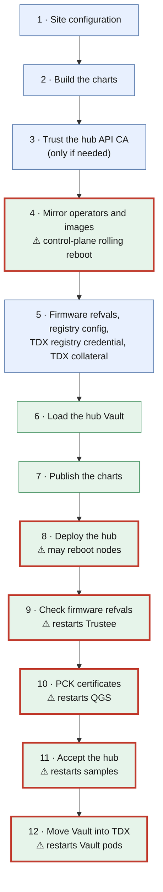
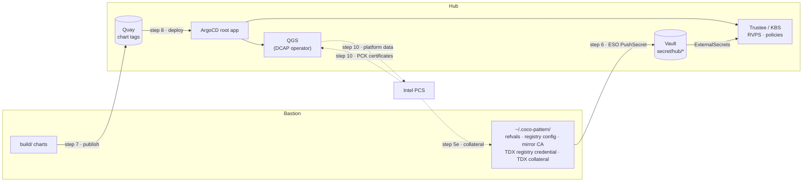

# Step reference: hub

[`install-hub.sh`](install.md#install-the-hub) runs these steps in order. This page says what
each step changes, how to check it and where to look when it fails. To run one step again,
use the installer step names given in each section:

```bash
APPLY=true ./scripts/install-hub.sh --only <step>     # that step only; other steps stay as they are
APPLY=true ./scripts/install-hub.sh --from <step>     # that step and every later one
```

The hub installs the trust anchor (Trustee/KBS, TDX collateral, reference values) that every
tenant uses; then onboard tenants ([tenant steps](manual-install-tenant.md)).
How the pieces fit together: [architecture.md](architecture.md). Beta limits:
[known-issues.md](known-issues.md). Fixes for failed steps: [troubleshooting.md](troubleshooting.md).

## Overview



Blue: bastion only (steps 5 and 10 reach Intel PCS from it). Green: the bastion changes the hub.
Red border: **Disruptive** (reboot or restart of attestation-critical pods).

| Step | Installer steps | Runs on | Changes | Disruptive |
|---|---|---|---|---|
| [1](#step-1-site-configuration) | (preparation) | Bastion | `deploy/env/<site>/` | |
| [2](#step-2-build-the-charts) | `build` | Bastion | `build/` | |
| [3](#step-3-trust-the-hub-api-certificate-only-if-needed) | (preparation) | Bastion | hub kubeconfig | |
| [4](#step-4-mirror-operators-and-images) | `mirror`, `mirror-wait` | Bastion → Hub | mirror registry, CatalogSources, IDMS/ITMS | control-plane reboot |
| [5](#step-5-collect-the-attestation-inputs) | `pcs-key` … `collateral` | Bastion (reads Hub, Intel PCS) | `~/.coco-pattern/`, Quay robots | |
| [6](#step-6-load-the-hub-vault) | `vault` | Bastion → Hub | `secret/hub/*` | |
| [7](#step-7-publish-the-charts) | `publish` | Bastion → Hub Quay | chart tags | |
| [8](#step-8-deploy-the-hub) | `deploy`, `deploy-wait` | Bastion → Hub | root Application and its apps | node reboots possible |
| [9](#step-9-check-the-firmware-reference-values) | `refvals-check`, `trustee-restart` | Bastion → Hub | Trustee restart | attestation gap |
| [10](#step-10-pck-certificates) | `pck` | Bastion (Intel PCS) → Hub | PCK certificate Secrets | QGS restart |
| [11](#step-11-accept-the-hub) | `accept` | Bastion → Hub | sample restarts | samples |
| [12](#step-12-move-vault-into-tdx) | `vault-tdx` | Bastion → Hub | Vault server pods | one Vault pod at a time |

### What the steps feed



## Before you start

The [installation prerequisites](install.md#before-you-start) apply; steps 1, 3, 5a and 5b are
the [preparation](install.md#prepare). **Disruptive** marks a step that reboots nodes or restarts
attestation-critical pods. Keep secrets in protected files, the environment or stdin, never argv
or Git.

## Shell setup

For the check commands on this page, run once in every shell, from `runbooks/configurations/intel-tdx`:

```bash
export SITE=<site>                         # deploy/env/<site>/site.env (step 1)
. deploy/env/$SITE/site.env                # MIRROR_HOME, HUB_KUBECONFIG, EXPECT_HUB_API_SERVER, ...
export PATH=$MIRROR_HOME/bin:$PATH         # oc, oc-mirror and helm of the mirror host, if not on PATH
export KUBECONFIG=$HUB_KUBECONFIG          # the oc commands below run against the hub
```

The installer and the step scripts need only `SITE`: they load the site file themselves and
refuse a kubeconfig whose server is not `EXPECT_HUB_API_SERVER`. Script headers document every
input and default.

## Step 1. Site configuration

Preparation: [Site configuration](install.md#site-configuration).

## Step 2. Build the charts

Fetches the pinned upstream sources and builds the charts, the pinned sample charts (`storage`,
`kbs-access-curl`, `hello-openshift`, `gpu-workload`) and the upstream helper scripts into `build/`
(`scripts/build-upstream.sh`).

**Installer step:** `build`. **Runs on:** Bastion; needs internet access, or a warm
`UPSTREAM_CACHE` with `OFFLINE=true`.

**Verify:** `ls build/charts build/pattern/scripts` lists the charts and scripts.

**If it fails:** check the build header's tools and pinned source cache; use `OFFLINE=true`
only with a complete cache.

## Step 3. Trust the hub API certificate (only if needed)

Preparation: [Trust the hub API certificate](install.md#trust-the-hub-api-certificate-only-if-needed).

## Step 4. Mirror operators and images

Mirrors the operators and workload images the pattern needs, then creates their CatalogSources
and image mirror sets (`scripts/mirror-coco-pattern.sh`; `APPLY=false` mirrors only).

**Installer steps:** `mirror`, `mirror-wait`. **Runs on:** Bastion, then Hub.
**Disruptive:** applying the mirror sets rolls a reboot through the control plane.

- The catalogs get distinct names (`cs-*-coco-v4-20`), so existing catalogs are not touched.
- The mirror sets are renamed with a `coco-` prefix. Never `oc apply` the raw `oc-mirror`
  IDMS/ITMS on a cluster that was mirrored before: the generic names already exist and the apply
  would replace the existing mirror mappings.
- Every package is pinned to one version, so a re-mirror cannot upgrade `Automatic` hub
  subscriptions.
- TLS is verified: the source registries against the system trust store, the mirror against
  `MIRROR_CA_FILE` (on a first run, the mirror registry's CA). `MIRROR_TLS_INSECURE=true` skips
  verification (warned).

**Verify:**

```bash
oc get mcp master            # UPDATED=True, UPDATING=False, DEGRADED=False
oc get clusteroperators      # all Available=True, none Degraded
oc get catalogsource -n openshift-marketplace | grep coco     # 3 catalogs, pods READY
```

**If it fails:** [Control-plane drain is stuck](troubleshooting.md#control-plane-drain-is-stuck),
[Mirror mappings were overwritten](troubleshooting.md#mirror-mappings-were-overwritten).

## Step 5. Collect the attestation inputs

Prepares the files that step 6 loads into Vault, in `~/.coco-pattern/`:

| Installer step | What | Output |
|---|---|---|
| `pcs-key` | 5a. checks the [Intel PCS API key](install.md#intel-pcs-api-key) (used in step 10) | |
| `registry-auth` | 5b. checks the [TDX registry credential](install.md#tdx-registry-credentials) | `$TDX_REGISTRY_AUTH_FILE` |
| `fw-refvals` | 5c. firmware reference values (`mr_td`, `rtmr_1`, `rtmr_2`, `xfam`) for the profile's pinned OSC version | `firmware-reference-values.json` |
| `registry-config` | 5d. guest image-pull configuration from the hub IDMS/ITMS (`scripts/collect-registry-config.sh`) | `registry-configuration.toml`, `mirror-ca.pem` |
| `dcap-tools`, `collateral` | 5e. TDX verification collateral (TCB info, QE identity, CRLs) from public Intel PCS endpoints, no API key | `dcap-offline/platform_collaterals.json` |

**Runs on:** Bastion (reads Hub, reaches Intel PCS, writes local material).

- The firmware collector runs `veritas` and `tdx-measure` on the bastion
  ([prerequisites](install.md#before-you-start)) and needs `cosign` on `PATH`. It sets `xfam` for
  `x87 sse avx avx512 pkru amx` (`e702060000000000`); CPUs that report a different `xfam` need
  `--xfam-features`.
- The registry configuration lists secure (HTTPS) mirrors plus the mirror CA. The CA comes from
  `MIRROR_CA_FILE` or, if that file does not exist, from the hub's `additionalTrustedCA`
  ConfigMap; it is never read from a TLS connection. `--insecure` is only for a mirror that serves
  plain HTTP (in image-rs `insecure = true` means "use HTTP"). It copies no credential.
- The collateral expires after about 30 days: refresh it as in
  [operations](operations-runbook.md#tdx-collateral-and-pck-certificates).
- These files are not secret, except the API key and `$TDX_REGISTRY_AUTH_FILE`.

**Verify:** `ls ~/.coco-pattern/` lists `firmware-reference-values.json`,
`registry-configuration.toml`, `mirror-ca.pem` and `dcap-offline/platform_collaterals.json`, and
`$TDX_REGISTRY_AUTH_FILE` exists with mode `0600`.

### 5b. TDX registry credentials

Preparation: [TDX registry credentials](install.md#tdx-registry-credentials).

## Step 6. Load the hub Vault

Writes `secret/hub/*` through ESO from the step 5 material (`scripts/load-existing-vault.sh`).
No command runs inside Vault pods.

**Installer step:** `vault`. **Runs on:** Bastion, then Hub.

Generated secrets are not overwritten (`FORCE_REGEN=true` replaces them); file-backed values
follow the local files. A missing file is skipped with a warning: missing firmware reference
values cause PolicyDeny, missing registry credentials leave `credential-eso` unsynced. Values go
through transient Secrets/PushSecrets, not ConfigMaps. `ONLY=<key>` loads one value.

**Verify:** exit 0 with `PASS: loaded ...`. When Trustee is deployed, the loader then waits until
its `registry-config` and `credential` Secrets match the loaded bytes; after the first deployment the
ExternalSecrets sync within about 15 seconds.

**If it fails:** [Vault loader push not Ready](troubleshooting.md#vault-loader-push-not-ready).

## Step 7. Publish the charts

Publishes the built charts, including the pinned samples, into hub Quay
(`scripts/publish-coco-charts.sh`; `DRY_RUN=true` packages and checks only).

**Installer step:** `publish`. **Runs on:** Bastion, then Hub Quay.

Existing tags must be identical; lookup errors fail closed. Enable registry-side tag immutability
too.
TLS uses `OCI_CA_FILE` (default `HUB_INGRESS_CA_FILE`); `OCI_INSECURE=true` is only for a
throwaway lab registry.

**Verify:** every chart is pushed or already present and identical.

**If it fails:** compare the conflicting content and correct the pins or the artifact. Do not
overwrite a released tag, including a pinned sample chart.

## Step 8. Deploy the hub

Creates the root ArgoCD Application and through it the operators, Trustee, the DCAP operator's
QGS, initdata and the samples (`scripts/deploy-coco-hub.sh`; without `APPLY` it prints the
manifests, not a live diff). `deploy-wait` waits for `kata-cc`, the TDX nodes, platform
registration and ArgoCD sync.

**Installer steps:** `deploy`, `deploy-wait`. **Runs on:** Bastion, then Hub.
**Disruptive:** KataConfig/TDX MachineConfigs can reboot nodes.

**Verify:**

```bash
oc get applications.argoproj.io -n openshift-gitops
oc get csv -A | grep -Ei 'sandbox|trustee|nfd|intel-device|intel-tdx-dcap'
oc get secrets -n intel-dcap-operator-system -l type=platform-data   # one per TDX node
```

The DCAP operator registers each TDX platform offline (one `platform-data` Secret per node). QGS
cannot sign quotes until step 10 imports the PCK certificates, so the samples cannot attest yet.

**If it fails:** [deployment troubleshooting](troubleshooting.md#scripts-and-deployment).

## Step 9. Check the firmware reference values

Checks that the collected measurements reached Trustee, then restarts it so the KBS loads them.

**Installer steps:** `refvals-check`, `trustee-restart`. **Runs on:** Bastion, then Hub.
**Disruptive:** restarting Trustee interrupts attestation.

**Verify:**

```bash
oc get externalsecret firmware-refvals-eso -n trustee-operator-system
oc get cm rvps-reference-values -n trustee-operator-system \
  -o jsonpath='{.data.reference_value}' | jq -r 'keys[]' | grep -E 'mr_td|rtmr|xfam'
```

The ExternalSecret is synced and `mr_td`, `rtmr_1`, `rtmr_2`, `xfam` are present.

**If it fails:** collect and load again (steps 5c, 6).

## Step 10. PCK certificates

QGS signs quotes with each platform's PCK certificate. `dcap-pck.py provision` exports the
platform data the DCAP operator wrote, fetches the PCK certificates from Intel PCS with your API
key ([what is sent](../README.md#data-sent-to-intel)), imports them as `<qe_id>-pck` Secrets and
restarts QGS. The request and response bundles are kept in `~/.coco-pattern/dcap-pck/hub/`, so a
rerun reuses them when nothing changed. The API key stays in the environment and is removed before
any tool runs.

**Installer step:** `pck`. **Runs on:** Bastion (Intel PCS), then Hub.
**Disruptive:** QGS restarts; quotes pause briefly.

**Verify:** one `<qe_id>-pck` Secret per `platform-data` Secret in `intel-dcap-operator-system`,
QGS pods Ready, and `./build/pattern/scripts/check-pck-expiry.sh` reports no expired certificate.

**If it fails:** [PCK certificate import fails](troubleshooting.md#pck-certificate-import-fails).

## Step 11. Accept the hub

Restarts the samples (`hello-openshift/secure`, `hello-openshift/insecure-policy`,
`kbs-access/kbs-access-curl`) and waits for them, with the tenant step 08 script
(`scripts/tenant/08-verify-attestation.sh`) pointed at the hub: they become Ready only with
attestation, guest image pull and resource release working together.

**Installer step:** `accept`. **Runs on:** Bastion, then Hub. **Disruptive:** restarts the samples.

**Verify:**

```bash
oc get externalsecret -n trustee-operator-system | grep -E 'registry-config|credential'
oc get job coco-initdata-gzipper -n imperative
oc logs -n trustee-operator-system deploy/trustee-deployment --since=15m \
  | grep -E 'POST /kbs/v0/attest|GET /kbs/v0/resource|PolicyDeny'
```

ExternalSecrets synced, gzipper complete, all samples Ready, successful attestation **and resource
release** for the sample guests. Successes in the shared log from unrelated guests are not enough.

**If it fails:** [troubleshooting](troubleshooting.md).

## Step 12. Move Vault into TDX

Step 8 deployed a Kyverno rule that starts the Vault server pods (namespace `vault`, labels
`app.kubernetes.io/name=vault`, `component=server`) in a `kata-cc` TDX guest with the locked
`initdata` and 8 GiB of guest memory. The rule is inactive until namespace `vault` carries the
label `coco.io/confidential-workloads=enabled`, so Vault pods recreated by the earlier reboots
stay on the default runtime. This step sets the label, then restarts the server pods one at a
time, standbys first and the active pod last, each only while every replica is Ready and unsealed
(otherwise a restart can lose raft quorum). The Sovereign Core Helm release is not modified.
`VAULT_TDX=false` skips the label.

From then on a Vault pod **starts only if hub attestation works**: its guest pulls images through
the KBS. See [Vault depends on hub attestation](known-issues.md#hub-vault-depends-on-hub-attestation).

**Installer step:** `vault-tdx`. **Runs on:** Bastion, then Hub. **Disruptive:** restarts one
Vault pod at a time; restarting the active pod causes a short leader election. Run it only after
step 11 passed.

**Verify:**

```bash
oc get pod -n vault -l app.kubernetes.io/name=vault,component=server \
  -L vault-active,vault-sealed -o custom-columns=NAME:.metadata.name,RUNTIME:.spec.runtimeClassName,READY:.status.containerStatuses[0].ready
oc get clustersecretstore
```

Every server pod runs `kata-cc`, Ready and unsealed; the ClusterSecretStore stays Ready; the
Trustee log shows `POST /kbs/v0/attest` and resource requests without `PolicyDeny` for each Vault
guest. `oc exec` and `oc port-forward` into Vault pods are refused from now on; these scripts
write Vault only through ESO PushSecrets.

**If it fails:** [Vault pod does not start in TDX](troubleshooting.md#vault-pod-does-not-start-in-tdx).
