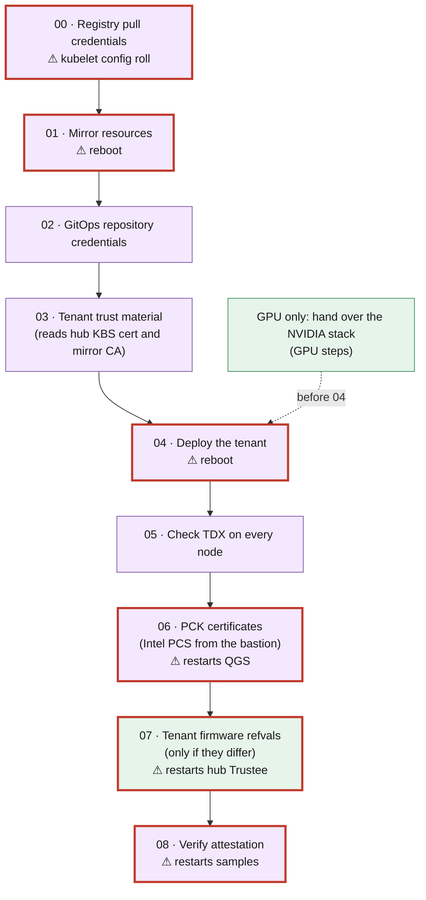
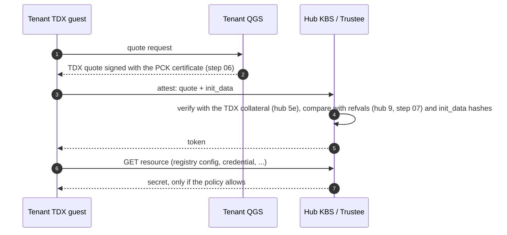

# Step reference: tenant

[`install-tenant.sh`](install.md#install-each-tenant) runs these steps in order for one tenant,
after the [hub](manual-install-hub.md); `PROFILE=gpu` adds the
[confidential GPU steps](manual-install-tenant-gpu.md). This page says what each step changes,
how to check it and where to look when it fails. To run one step again, use the installer step
names given in each section:

```bash
APPLY=true ./scripts/install-tenant.sh --only <step>     # that step only; other steps stay as they are
APPLY=true ./scripts/install-tenant.sh --from <step>     # that step and every later one
```

Steps that call a step script (`scripts/tenant/NN-*.sh`) can also run it directly: without
`APPLY=true` it shows what it would change.

How it works: [architecture.md](architecture.md). Beta limits: [known-issues.md](known-issues.md).
Fixes for failed steps: [troubleshooting.md](troubleshooting.md).

## Overview



Purple: changes the tenant. Green: changes the hub. Red border: **Disruptive**. Step numbers are
the script names; the GPU handover runs before 04.

| Step | Installer steps | Runs on | Changes | Disruptive |
|---|---|---|---|---|
| [00](#step-00-registry-pull-credentials) | `pull-creds`, `pull-creds-wait` | Bastion → Tenant | global pull secret | kubelet config roll |
| [01](#step-01-mirror-resources) | `mirror`, `mirror-wait` | Bastion → Tenant | CatalogSources, IDMS/ITMS | reboot |
| [02](#step-02-gitops-repository-credentials) | `gitops` | Bastion (reads Hub) → Tenant | ArgoCD repo credential, TLS trust | |
| [03](#step-03-load-tenant-trust-material) | `kbs-cert`, `mirror-ca` | Bastion (reads Hub) → Tenant | tenant Vault `kbsRouteCert`, `mirrorCA` | |
| [04](#step-04-deploy-the-tenant) | `deploy`, `deploy-wait` | Bastion → Tenant | root Application and its apps | reboot |
| [05](#step-05-check-tdx-on-every-tenant-workload-node) | `host-check` | Bastion → Tenant | none (read-only) | |
| [06](#step-06-pck-certificates) | `pck` | Bastion (Intel PCS) → Tenant | PCK certificate Secrets | QGS restart |
| [07](#step-07-tenant-firmware-reference-values-only-if-they-differ-from-the-hub) | `refvals-collect`, `refvals-load`, `refvals-restart` | Bastion (reads Tenant) → Hub | hub refvals | hub Trustee restart |
| [08](#step-08-verify-attestation) | `verify` | Bastion → Tenant | sample restarts | samples |

### How a tenant guest gets its secrets



## Before you start

The [installation prerequisites](install.md#before-you-start) apply, including the
[TDX registry credential](install.md#tdx-registry-credentials). **Disruptive** marks reboots and
service or workload outages; on a single-node tenant every reboot takes the API down until
`oc get mcp` (tenant) settles.

## Shell setup

For the check commands on this page, run once in every shell, from `runbooks/configurations/intel-tdx`:

```bash
export SITE=<site>                         # deploy/env/<site>/site.env
. deploy/env/$SITE/site.env                # TENANT_KUBECONFIG, HUB_KUBECONFIG, EXPECT_*_API_SERVER, ...
export PATH=$MIRROR_HOME/bin:$PATH         # oc of the mirror host, if not on PATH
grep server: "$TENANT_KUBECONFIG"; echo "$EXPECT_TENANT_API_SERVER"   # must be the same URL
```

Check commands are labelled with the cluster they run against (`(tenant)`, `(hub)`, or the
`export KUBECONFIG=...` to run first). The installer and the step scripts need only `SITE`: they
default to the site's kubeconfigs and refuse one whose server is not the expected URL.

## Step 00. Registry pull credentials

> **Important:** the tenant nodes pull the pattern's operator catalogs and images from the mirror
> with these robots. The credential must cover every org the pattern's mirror run fills, not only
> the guests' orgs: see [TDX registry credentials](install.md#tdx-registry-credentials), "if you
> also install tenants".

Adds the TDX registry robots to the tenant's global pull secret
(`scripts/tenant/00-add-mirror-pull-creds.sh`), each under its exact key (`host/org`). A key the
tenant already holds for the same robot gets the new token (rerun after a rotation); a key held by
another user is kept, and every other entry (Sovereign Core's read-only entries, even on the same
host) stays as it is. A file with an admin-looking user is refused.

**Installer steps:** `pull-creds`, `pull-creds-wait`. **Runs on:** Bastion, changes the Tenant.
**Disruptive:** rolls the kubelet config.

**Verify:** the preview lists `+` for keys the tenant did not have, `~` for rotated robot
tokens, `=` for keys kept for another user; a second run prints `nothing to change`.

**If it fails:** validate the credential file as in [TDX registry credentials](install.md#tdx-registry-credentials).
Resolve any exact key held by another user before relying on that credential.

## Step 01. Mirror resources

Applies the coco CatalogSources and image mirror sets that the hub mirror (hub step 4)
generated (`scripts/tenant/01-apply-mirror-resources.sh`). Nothing is mirrored again. The mirror
sets get a `coco-` prefix, so the change is additive, and every source that the mirror run gave
only a tag mirror also gets a digest mirror (`coco-idms-tag-sources`). The script waits for the
packagemanifests.

**Installer steps:** `mirror`, `mirror-wait`. **Runs on:** Bastion, then Tenant.
**Disruptive:** reboots a single-node tenant.

**Verify:** `oc get mcp` (tenant) shows `UPDATED=True`, `UPDATING=False`.

**If it fails:** [Tenant API down during a reboot](troubleshooting.md#tenant-api-down-during-a-reboot).

## Step 02. GitOps repository credentials

Gives the tenant ArgoCD an OCI repository credential for the hub Quay and its TLS trust
(`scripts/tenant/02-ensure-gitops-repo-creds.sh`). The credential is the hub's
`quay-oci-repo-creds` with the username and password of the TDX robot for
`CHART_REGISTRY/OCI_ORG`: the hub's own push user never leaves the hub.

**Installer step:** `gitops`. **Runs on:** Bastion, reads the Hub, changes the Tenant.

If the tenant has no GitOps operator, set `INSTALL_GITOPS=true`. It installs the hub's version
(`gitops-1.19`, Manual approval) from the tenant catalog that carries it, found by itself (on a
Sovereign Core tenant: `mirror-redhat-operators`); `GITOPS_SOURCE` overrides the choice.

**Verify:** `oc get secret quay-oci-repo-creds -n openshift-gitops` (tenant) and
`oc get cm argocd-tls-certs-cm -n openshift-gitops` (tenant) exist.

**If it fails:** check the selected robot's read scope, the GitOps catalog and the hub TLS trust.

## Step 03. Load tenant trust material

Copies the KBS certificate and the mirror CA byte for byte into the tenant Vault
(`scripts/tenant/03-load-kbs-route-cert.sh`, `03b-copy-hub-secrets-to-vaultaas.sh`); both are
measured by initdata. The certificate comes from the authenticated hub API Secret
`imperative/kbs-tls-self-signed`, the CA from `imperative/registry-ca`. Transient
Secrets/PushSecrets are removed after ESO writes `secret/data/<clusterName>/{kbsRouteCert,mirrorCA}`.

**Installer steps:** `kbs-cert`, `mirror-ca`. **Runs on:** Bastion, reads Hub, writes Tenant
through ESO PushSecret.

**Verify:** the scripts finish successfully; after deployment,
`oc get externalsecret -n imperative` (tenant) shows both synced.

**If it fails:** [PushSecret diagnosis](troubleshooting.md#vault-loader-push-not-ready)
or [KBS TLS](troubleshooting.md#guest-tls-to-the-kbs-fails). The tenant Vault policy must
permit `secret/data/<clusterName>/*`, where `<clusterName>` is the first label of the tenant's
base domain (`oc get dns.config cluster -o jsonpath='{.spec.baseDomain}'`), not `TENANT_CLUSTER`.

## Step 04. Deploy the tenant

Creates the tenant's root ArgoCD Application (`scripts/deploy-coco-spoke.sh`). It installs the
TDX MachineConfig, NFD, sandboxed containers and KataConfig, the SGX plugin, the DCAP operator's
QGS, Kyverno and policies, `coco-initdata` and the samples; with `TENANT_AGENT_NAMESPACE` set
also the CUGA agent's rules (`deploy/spoke/values-cuga-agent.yaml`). It raises the tenant ArgoCD
application controller memory limit to at least `ARGOCD_CONTROLLER_MEMORY` (default `8Gi`). `deploy-wait` waits for
`kata-cc`, the TDX nodes, platform registration and ArgoCD sync, and starts one new sync of an
application whose last sync failed or that drifted since.

**Installer steps:** `deploy`, `deploy-wait`. **Runs on:** Bastion, then Tenant.
**Disruptive:** the TDX MachineConfig reboots a single-node tenant.

**Verify:**

Tenant (`export KUBECONFIG=$TENANT_KUBECONFIG`):

```bash
oc get mcp                                                # settled
oc get applications.argoproj.io -n openshift-gitops       # child apps Synced/Healthy
oc get secrets -n intel-dcap-operator-system -l type=platform-data   # one per TDX node
```

The samples cannot attest until step 06 imports the PCK certificates.

**If it fails:** [deployment troubleshooting](troubleshooting.md#scripts-and-deployment).

## Step 05. Check TDX on every tenant workload node

After the MachineConfig reboot, checks that NFD found TDX on every TDX node and that the
`kata-cc` runtime exists (`scripts/tenant/05-verify-tdx-host.sh`, once per node).

**Installer step:** `host-check`. **Runs on:** Bastion, reads Tenant.

**Verify:** PASS for the TDX label and `kata-cc` on every node.

**If it fails:** [TDX does not initialise](troubleshooting.md#tdx-does-not-initialise).

## Step 06. PCK certificates

As on the hub ([hub step 10](manual-install-hub.md#step-10-pck-certificates)): `dcap-pck.py
provision` fetches the PCK certificate of each tenant TDX platform from Intel PCS and imports it
as a Secret; the bundles are kept per tenant in `~/.coco-pattern/dcap-pck/<TENANT_CLUSTER>/`.
Nothing changes on the hub: its TDX collateral covers every TDX platform type.

**Installer step:** `pck`. **Runs on:** Bastion (Intel PCS), then Tenant.
**Disruptive:** QGS restarts.

**Verify:** one `<qe_id>-pck` Secret per `platform-data` Secret, QGS pods Ready.

**If it fails:** [PCK certificate import fails](troubleshooting.md#pck-certificate-import-fails).

## Step 07. Tenant firmware reference values (only if they differ from the hub)

The hub RVPS must hold the tenant guests' firmware measurements. If the tenant runs the same
OpenShift and sandboxed-containers versions as the hub, they are usually the same.
`refvals-collect` measures the tenant's guest firmware for the tenant's profile into
`~/.coco-pattern/firmware-reference-values-<TENANT_CLUSTER>.json`. `refvals-load` merges them into
the hub file as a union (with a timestamped backup; the hub's values are never replaced) and loads
it into the hub Vault only if something was added; `refvals-restart` then restarts the hub
Trustee.

**Installer steps:** `refvals-collect`, `refvals-load`, `refvals-restart`. **Runs on:** Bastion,
reads the Tenant; changes the Hub only if the values differ. **Disruptive:** restarting Trustee
briefly interrupts attestation for all tenants.

**Verify:** the hub RVPS contains the tenant values:

Hub (`export KUBECONFIG=$HUB_KUBECONFIG`):

```bash
oc get cm rvps-reference-values -n trustee-operator-system -o jsonpath='{.data.reference_value}' \
  | jq -r 'to_entries[] | "\(.key) \(.value | gsub("-"; "+") | gsub("_"; "/") | . + ("=" * ((4 - length % 4) % 4)) | @base64d | fromjson | .value)"'
```

## Step 08. Verify attestation

Restarts the tenant CPU samples and checks them against the central KBS
(`scripts/tenant/08-verify-attestation.sh`).

**Installer step:** `verify`. **Runs on:** Bastion, then Tenant; reads Hub logs.
**Disruptive:** restarts the sample pods.

**Verify:** `END-TO-END` PASS: all expected samples exist and their restarted pods become Ready
(`hello-openshift/secure`, `hello-openshift/insecure-policy`, `kbs-access/kbs-access-curl`).
Accept successful attestation **and resource release**, plus workload readiness; hub log counts
include other guests and cannot by themselves prove this tenant attested. For GPUs, also complete
[GPU acceptance](manual-install-tenant-gpu.md#g10-move-the-llm-into-a-tdx-guest) and the
application inference and login checks.

**If it fails:** [troubleshooting](troubleshooting.md).
