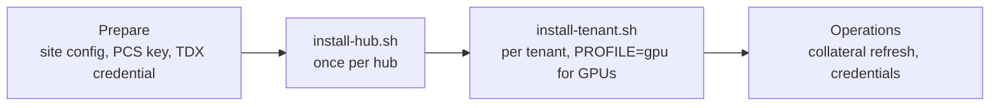

# Intel TDX on IBM Sovereign Core

Run tenant workloads in Intel TDX guests (`kata-cc`), optionally with NVIDIA Hopper
confidential GPUs. The management hub hosts Trustee/KBS and Vault;
tenant guests attest to the central KBS for resource release.

**Beta.** Read the [security and support limits](known-issues.md) before deployment,
then the [architecture](architecture.md). Abbreviations are in the [glossary](glossary.md). Validated scenarios are the CPU samples
(`hello-openshift`, `kbs-access`) and AI inference with an H200 plus a CPU-only CUGA guest.
`spoke` remains in filenames and Application names; this documentation calls it a tenant.

## Prerequisites

### Component versions used in validation

| Component | Version | Maturity |
|---|---|---|
| This integration (charts, scripts, compliance check) | Current integration | **Beta** |
| IBM Sovereign Core | 1.1.0 | Vendor release |
| OpenShift Container Platform | 4.20 (validated on 4.20.21) | GA |
| OpenShift sandboxed containers | 1.13.1 | Vendor release |
| Trustee operator / trustee chart | 1.2.1 / see `deploy/versions.yaml` | Vendor release / **Beta** (patched) |
| Intel Device Plugins operator (SGX) | 0.36.0 | Vendor release |
| Intel TDX DCAP operator (QGS, platform registration) | 0.1.0, `alpha` channel | **Alpha** |
| Node Feature Discovery | 4.20 | Vendor release |
| NVIDIA GPU Operator (confidential GPU only) | 26.3.0 | Vendor release |
| NVIDIA verifier `Local` mode; H200 | Trustee built-in | **Not supported by Red Hat** |
| Kyverno chart | 3.7.2 | Community |
| coco-pattern / clustergroup chart | v7.6.0 / 0.9.58 | Community |

"Vendor release" means the support status of the bare-metal confidential-containers features
is as the vendor documents it for that version; check it before you plan production use.

Chart versions are pinned in `deploy/versions.yaml` and the upstream sources in `upstream/lock`.
`coco-initdata` must be the same version on the hub and every tenant.

### Hardware prerequisites

- Intel Xeon with TDX, set up as described in Intel's TDX enabling guide:
  [Hardware Setup](https://cc-enabling.trustedservices.intel.com/intel-tdx-enabling-guide/04/hardware_setup/).
- Confidential GPU: NVIDIA Hopper (H100/H200) with CC-capable firmware, and IOMMU enabled.

## Execution and air-gap boundaries

Use **Bash**, from `runbooks/configurations/intel-tdx`. The installers and each step reference page
supply the shell setup: `SITE`, the site file, explicit hub/tenant kubeconfigs and `oc` (hub)/`oc` (tenant) clients.
Check both expected API URLs before using them. Script headers are the reference for
inputs, effects and defaults; most scripts have no `--help`.

| Location | Access and material |
|---|---|
| Connected GPU host | NVIDIA RIM/OCSP for GPU reference values (only if the bastion cannot reach them); transfers verified values to the bastion. It need not reach a cluster. |
| Bastion | Internet access (upstream sources, source registries, the firmware collector image), repository, local tools, trusted CA files, hub/tenant APIs and site registries. Builds, mirrors, imports material and deploys. Keep credentials in protected files, never argv or Git. |
| Hub/tenant | Site services only. The KBS verifies quotes from collateral in Vault, QGS uses imported PCK certificates, and the NVIDIA verifier uses `Local` mode; nothing refreshes them inside the gap. |

**Disruptive** marks reboots or service/workload outages. Plan a maintenance window;
a single-node tenant loses its API and workloads on each reboot. `APPLY` is specific
to each script: mirroring still writes registries with `APPLY=false`, publishing
pushes by default, and CA embedding edits kubeconfig immediately.

## Deployment sequence

**Install with the scripts: [installation guide](install.md).** Prepare the site, then run
`APPLY=true ./scripts/install-hub.sh` once and `APPLY=true ./scripts/install-tenant.sh` per tenant (`PROFILE=gpu` for
confidential GPUs). They stop where only you can act and continue with `--resume`.



| Task | Procedure |
|---|---|
| Install the hub and tenants | [Installation guide](install.md) (default). |
| Run or fix single steps | Step reference: [hub](manual-install-hub.md), [tenant](manual-install-tenant.md), [confidential GPU tenant](manual-install-tenant-gpu.md). |
| Operate and recover | [Operations](operations-runbook.md), [troubleshooting](troubleshooting.md). |

Acceptance: the samples' restarted pods become Ready, which needs attestation and resource
release; shared Trustee logs alone cannot identify a tenant's attestation. For GPUs, also
check inference and the agent login.

## Guest sizing

Guest writable storage is RAM-backed (about half guest memory). Allocate about twice
the unpacked image size plus workload space; the VM also sits inside the pod memory
cgroup, so the container request/limit must cover its working set. Guest RAM alone
cannot prevent cgroup OOM.

CPU workloads (`confidentialWorkloads`, for example the CUGA agent) get a fixed size: the rule sets
`defaultMemoryMiB` as the guest memory and `memoryLimit` as the container limit, replacing any
annotation in the pod. The rest of this section is for confidential GPU workloads.

The Kyverno GPU rule picks the guest size in this order: the pod's own
`io.katacontainers.config.hypervisor.default_memory` annotation, then the first
`confidentialGpu.models` entry whose `podSelector` matches, then `defaultMemoryMiB`. The
memory request is set to that size and the limit to that size plus `memoryOverheadMiB`.
Add one `models` entry per model, sized as recommended below.

A workload owner can override the size by setting the annotation in the pod template:

```yaml
metadata:
  annotations:
    io.katacontainers.config.hypervisor.default_memory: "98304"            # MiB, a whole number
    io.katacontainers.config.runtime.create_container_timeout: "1800"      # optional, seconds
```

GPU memory and MIG do not change this: the guest rootfs holds the model image, so guest
RAM scales with image bytes. The confidential runtime passes the whole GPU to one guest
(`nvidia.com/pgpu`). MIG inside that guest only splits the GPU between processes of that
one pod.

**Recommendation**, for all images the guest pulls (for an LLM: the model image and the runtime
image), from their unpacked size (`crictl images` on a node that has pulled them reports it):

- **Guest memory** (`memoryMiB`, or the `default_memory` annotation): twice the unpacked size plus
  8 GiB for the guest kernel, agent and workload, rounded up to a multiple of 8 GiB.
- **Container memory limit:** guest memory plus `memoryOverheadMiB` (qemu and virtiofsd outside
  the guest, 4096 MiB by default). The Kyverno rule sets it from the guest memory.
- **Pull timeout** (`createContainerTimeoutSec`, or the `create_container_timeout` annotation):
  20 minutes (1200 s).

Example: a 16 GiB runtime image and a 14 GiB model image (unpacked) need a guest of
2 × 30 + 8 = 68, rounded to 72 GiB (73728 MiB).

**Verify:** on the node, `tr '\0' '\n' < /proc/<qemu-kvm-pid>/cmdline | grep -A1 -x -- -m` shows
the actual guest RAM.
The GPU profile sets kubelet `runtimeRequestTimeout` to 20m. Applying it the first time reboots
the node (MachineConfig change) ([timeout procedure](troubleshooting.md#guest-pull-times-out)).
The effective pull timeout is the lower of kubelet and Kata timeouts.

**If it fails:** diagnose in order: host TDX/SGX → attestation/`gpu0` → resource release
→ memory → pull completion → application CUDA. Clear a [stranded GPU](troubleshooting.md#stranded-gpu-after-a-failed-pod)
before retrying; verify device ownership before force deletion and never use `crictl rmp -f`.

## Moving another workload into a TDX guest

Use the owning controller's supported extension point for runtime, initdata and memory;
use admission mutation where the owner offers none. Direct Deployment edits are temporary.
Add the namespace to `workloadNamespaces` and wait for both initdata ConfigMaps before
creating a confidential pod. A mounted filesystem PVC remains on host-managed storage,
outside the TEE. Apply the same attestation/resource-release and application acceptance checks.

## Import the compliance check

The import takes a zip with the workflow JSON at its top level:

```bash
(cd compliance && zip ../LLM_TDX_GPU_Check.zip LLM_TDX_GPU_Check.json)
```

In Compliance center Workflows, open **Workflows**, click **Import** and select the zip. Your role
needs View, Execute and Edit on the admin and user folders. See the IBM Sovereign Core
documentation: *Compliance center Workflows → Importing and exporting workflows*, and
*Authenticating from Compliance center Workflows to IBM Sovereign Compliance center* for the
credentials it uses.

Then set its required input variables: `SpokeHostname` and `HubHostname` to the tenant and hub
API URLs (`EXPECT_TENANT_API_SERVER`, `EXPECT_HUB_API_SERVER` in `site.env`), and `spoke_ocp_auth`,
`hub_ocp_auth`, `concert_auth_key` to your Compliance center credential names. All variables and
the access the tokens need: [compliance check workflow](compliance-workflow.md).

**Verify:** the workflow is listed as `LLM_TDX_GPU_Check`; **Run** completes and the assessment
appears under **Compliance → Postures**.

The check passes only if every non-terminating GPU-requesting LLM pod runs in a TDX guest with a
confidential GPU and boots the locked `initdata`. It checks configuration, not attestation
evidence ([known issues](known-issues.md)).

## Repository references

[Profiles](../deploy/README.md).
